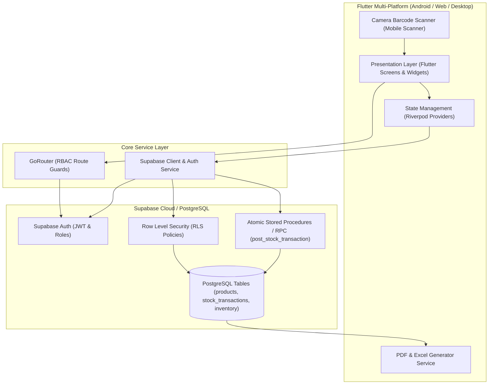
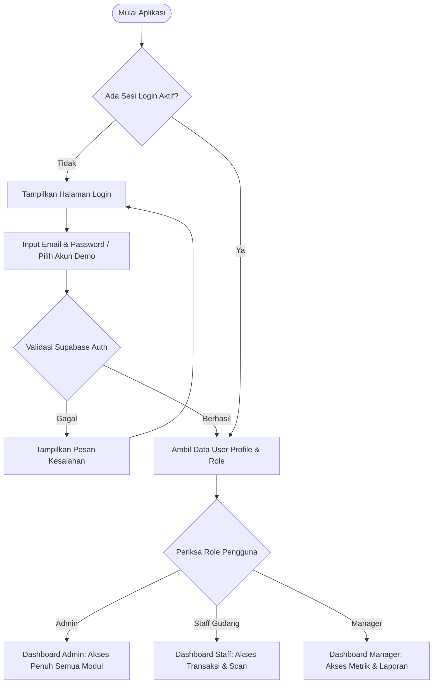
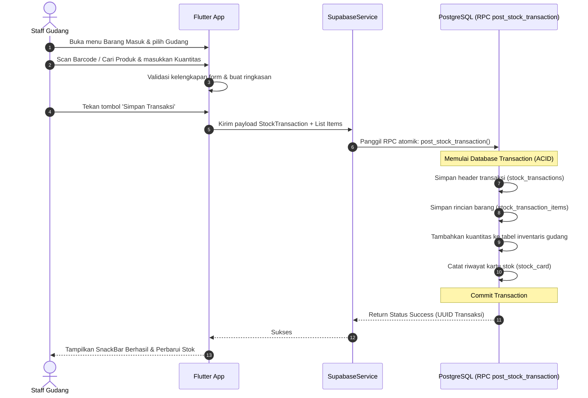
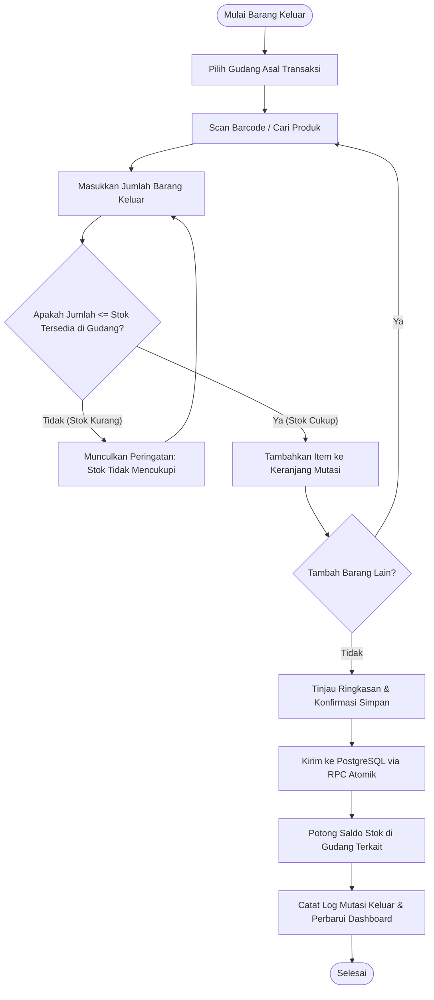
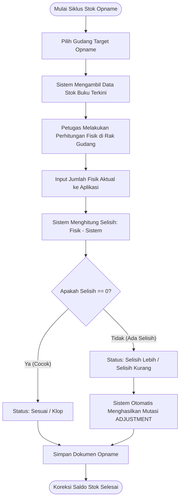

# 📦 Warehouse Stock Management System (Aplikasi Manajemen Stok Gudang)

[](https://flutter.dev)
[](https://dart.dev)
[](https://supabase.com)
[](https://riverpod.dev)
[](https://maestro.mobile.dev)
[](LICENSE)

Aplikasi manajemen inventaris dan stok gudang modern multi-platform (**Android**, **Web**, dan **Desktop**) berbasis **Flutter** dan **Supabase**. Dirancang dengan arsitektur modular (*Feature-First*), mengedepankan integritas data mutasi stok yang **atomik**, pelacakan barcode/QR code cepat, serta dilengkapi antarmuka pengujian otomatis **Maestro E2E Testing**.

---

## 👨‍🎓 Informasi Pengembang & Proyek

Tabel identitas pengembang / mahasiswa untuk keperluan pengumpulan tugas, ujian praktikum, atau portofolio proyek:

| Komponen | Keterangan |
|---|---|
| **Nama Lengkap** | Tomy Anugerah Islami |
| **NIM** | [230103239] |
| **Kelas** | [ 23 TI B1 ] |
| **Program Studi** | [S1 TEKNIK INFORMATIK] |
| **Fakultas / Universitas**| [Universitas DUTA BANGSA SURAKARTA] |
| **Mata Kuliah** | [MOBILE TESTING] |
| **Dosen Pengampu** | [Triyono M.KOM] |
| **Tautan Repository** | [https://github.com/tomyanugerahislami/Stok-Gudang-App](https://github.com/tomyanugerahislami/Stok-Gudang-App) |
| **Versi Aplikasi** | v1.0.0 (Release) |

---

## 🎯 1. Tujuan Aplikasi

Aplikasi **Warehouse Stock Management** dibangun untuk mengatasi berbagai kendala manual dalam manajemen pergudangan konvensional, antara lain:

1. **Digitalisasi & Efisiensi Pencatatan**: Menggantikan pencatatan buku besar atau spreadsheet terpisah dengan sistem database terpusat berbasis cloud PostgreSQL.
2. **Pencegahan Human-Error**: Menggunakan pemindaian barcode/QR code otomatis untuk mengidentifikasi produk secara instan tanpa kesalahan ketik nomor SKU/seri.
3. **Integritas Mutasi Atomik**: Menjamin saldo stok selalu valid dan konsisten melalui transaksi *Remote Procedure Call (RPC)* PostgreSQL. Kuantitas stok tidak dapat bernilai negatif (*stock out underflow protection*).
4. **Audit Trail & Transparansi**: Setiap pergerakan barang (Masuk, Keluar, Opname, Pembatalan) tercatat lengkap dengan identitas operator, nomor dokumen referensi, gudang asal/tujuan, dan stempel waktu (*timestamp*).
5. **Visibilitas Stok & Laporan Cepat**: Memberikan notifikasi peringatan dini ketika produk mencapai batas stok minimum (*low stock alert*) serta kemudahan ekspor laporan resmi dalam format PDF dan Excel (.xlsx).

---

## 🚀 2. Fitur Utama

### 🔐 2.1 Autentikasi & Multi-Role Access Control (RBAC)
Sistem memiliki kontrol otorisasi berlapis di sisi aplikasi dan *Row Level Security (RLS)* database:
- **Admin**: Akses menyeluruh ke semua modul (Katalog produk, Master data, Transaksi, Opname, Laporan, Manajemen Role Pengguna).
- **Staff Gudang**: Akses operasional harian (Pencatatan barang masuk, barang keluar, pemindaian barcode, dan stok opname).
- **Manager**: Pemantauan tingkat tinggi (Melihat analitik dashboard, kartu stok mutasi, persetujuan transaksi, serta cetak laporan PDF/Excel).
- **Fitur Demo / Offline Sim**: Dapat dicoba langsung dengan akun simulasi cepat (`admin@stokgudang.com`, `staff@stokgudang.com`, `manager@stokgudang.com`).

### 📊 2.2 Dashboard Interaktif & Metrik Bisnis
- Ringkasan total produk aktif, total unit stok di semua gudang.
- Rekapitulasi volume barang masuk (*stock in*) dan keluar (*stock out*) hari berjalan.
- **Peringatan Stok Menipis**: Banner kartu khusus untuk barang yang jumlahnya berada di bawah nilai *minimum stock*.
- Log 5 transaksi mutasi terakhir lengkap dengan status dan jenis transaksi.
- Filter gudang aktif di bagian atas antarmuka.

### 🏷️ 2.3 Manajemen Master Data Produk
- Input produk lengkap: SKU unik, Nama, Kategori, Satuan (Pcs, Box, Kg, Liter, dll.), Barcode unik, Stok minimum, dan Harga modal.
- Fitur auto-generate SKU dan nomor barcode sesuai standar industri.
- Pencarian cerdas *real-time* berdasarkan nama produk, SKU, maupun scan barcode.
- Filter berdasarkan kategori dan status (Aktif / Diarsipkan).
- Proteksi penghapusan: Produk yang sudah memiliki rekam jejak transaksi tidak dapat dihapus permanen, melainkan diarsipkan.

### 📷 2.4 Barcode Generator & Scanner
- Generator Barcode otomatis mendukung format **Code 128 (1D)** dan **QR Code (2D)**.
- Pemindai kamera terintegrasi (`mobile_scanner`) dengan fitur *torch/flashlight* dan *switch camera*.
- Input manual kode barcode untuk perangkat desktop/web tanpa kamera.
- Cetak label stiker barcode satuan maupun batch (pilihan: 1, 4, 12, 24 label per lembar).
- Ekspor lembar label barcode ke dokumen **PDF** atau cetak langsung ke printer Bluetooth/Thermal/A4.

### 📥 2.5 Transaksi Barang Masuk (Stock In)
- Pemilihan gudang tujuan, tanggal penerimaan, supplier/pemasok, dan nomor surat jalan/dokumen.
- Multi-item entry: Menambahkan beberapa produk sekaligus dalam satu nomor transaksi.
- Pratinjau dialog konfirmasi sebelum data diposting ke database.
- Eksekusi posting transaksi secara atomik (stok bertambah seketika di tabel inventaris).

### 📤 2.6 Transaksi Barang Keluar (Stock Out)
- Pemilihan gudang asal, tanggal pengeluaran, pihak penerima/pelanggan, dan nomor referensi.
- **Validasi Stok Real-Time**: Sistem secara otomatis mengecek saldo stok fisik di gudang terkait. Jika permintaan keluar melebihi stok tersedia, sistem menolak dan memberikan indikasi visual.
- Eksekusi atomik pemotongan kuantitas stok di server database.

### 📋 2.7 Inventaris, Kartu Stok, & Stok Opname
- **Tabel Inventaris Terkini**: Daftar kuantitas stok per gudang dengan label status (AMAN / MENIPIS).
- **Kartu Stok (Stock Card)**: Rekam jejak seluruh mutasi per item produk dengan perhitungan saldo berjalan (*running balance*).
- **Stok Opname**: Modul audit fisik berkala. Membandingkan stok sistem dengan perhitungan fisik langsung di lapangan, otomatis menghitung selisih (*variance*), dan mencatat mutasi penyesuaian (*ADJUSTMENT*).
- **Pembatalan Transaksi**: Fasilitas rollback transaksi berstatus COMPLETED dengan pengembalian kuantitas stok secara otomatis dan pencatatan audit log pembatalan.

### 📑 2.8 Laporan & Ekspor Data
- Rekapitulasi pergerakan stok berdasarkan rentang tanggal, filter gudang, dan jenis transaksi.
- Ekspor ke **PDF resmi** dengan tata letak landscape rapi, header identitas perusahaan/gudang, dan tanda tangan penanggung jawab.
- Ekspor ke **Excel (.xlsx)** untuk analisis lanjutan dengan formula spreadsheet.

### 🧪 2.9 Maestro Automated End-to-End (E2E) Testing
- Terintegrasi penuh dengan suite pengujian UI otomatis berbasis Maestro.
- Memiliki layar **Maestro Test Screen** di dalam aplikasi untuk memantau, melihat kode test YAML, dan mengeksekusi test langsung dari antarmuka Flutter.

---

## 🔄 3. Flowchart Sistem

### 3.1 Diagram Arsitektur Aplikasi



---

### 3.2 Flowchart Autentikasi & Hak Akses Pengguna



---

### 3.3 Flowchart Transaksi Barang Masuk (Stock In)



---

### 3.4 Flowchart Transaksi Barang Keluar (Stock Out) & Proteksi Stok Minus



---

### 3.5 Flowchart Siklus Stok Opname (Pemeriksaan Fisik)



---

## 🤖 4. Maestro E2E Testing

Aplikasi ini telah dilengkapi dengan skenario pengujian UI / End-to-End modern menggunakan **Maestro**. Seluruh skenario pengujian otomatis tersimpan di folder `maestro/`.

### 4.1 Daftar Skenario Pengujian

| No | File Skenario | Target Pengujian | Deskripsi Pengujian |
|:---:|---|---|---|
| **01** | `01_login_auth_validasi.yaml` | Login Auth & Validasi | Menguji validasi form kosong (pesan error email & password), validasi format email salah, serta login sukses via role demo admin menggunakan selector ID. |
| **02** | `02_navigasi_antar_menu.yaml` | Navigasi Antar Menu | Memvalidasi navigasi perpindahan layar melalui Bottom Navigation Bar (Dashboard, Produk, Barang Masuk, Stok & Mutasi) dan Floating Action Button (Scan Barcode). |
| **03** | `03_crud_produk.yaml` | CRUD Master Produk | Menguji alur penambahan produk baru (Create), pencarian produk di katalog (Read), verifikasi data master, serta melihat rincian produk (Detail/Update). |
| **04** | `04_scan_dan_mutasi_stok.yaml` | Scan & Mutasi Stok | Menguji pemindaian barcode manual pada scanner kamera serta pengecekan mutasi stok fisik di tab Stok Terkini dan tab Riwayat Seluruh Mutasi. |

---

### 4.2 In-App Maestro Test Screen

Aplikasi memiliki layar antarmuka khusus (`lib/features/testing/maestro_test_screen.dart`) yang memungkinkan penguji atau dosen untuk:
1. Meninjau kode skrip YAML dari setiap test secara langsung di dalam aplikasi dengan syntax highlighting.
2. Menjalankan skenario pengujian langsung via tombol GUI (*Run Test* atau *Run All Tests*).
3. Melihat status eksekusi *real-time* (Running, Passed, Failed) beserta stempel durasi dan log konsol lengkap (*exit code* & output terminal).

---

### 4.3 Menjalankan Maestro via Terminal / Command Line

#### A. Prasyarat Instalasi Maestro di Windows
Jika belum terpasang, instal Maestro melalui PowerShell:
```powershell
# Menggunakan curl / iwr
curl -fsSL "https://get.maestro.mobile.dev" | bash
```
Atau jika menggunakan Android emulator / device fisik yang terhubung via ADB:
```bash
# Pastikan perangkat terdeteksi
adb devices
```

#### B. Menjalankan Satu Skenario Test
```bash
# Jalankan test login auth & validasi
maestro test maestro/01_login_auth_validasi.yaml

# Jalankan test navigasi menu
maestro test maestro/02_navigasi_antar_menu.yaml

# Jalankan test CRUD produk
maestro test maestro/03_crud_produk.yaml

# Jalankan test scan & mutasi stok
maestro test maestro/04_scan_dan_mutasi_stok.yaml
```

#### C. Menjalankan Seluruh Rangkaian Test (Batch)
```bash
# Jalankan seluruh folder maestro
maestro test maestro/
```

---

## 🛠️ 5. Teknologi & Dependensi

| Kategori | Teknologi / Package | Fungsi Utama |
|---|---|---|
| **Framework** | Flutter 3.x (Dart 3.x) | Framework UI multi-platform cross-device |
| **Backend & Database** | Supabase (PostgreSQL 15) | Database relasional, Auth, Row Level Security (RLS), & RPC |
| **State Management** | `flutter_riverpod: ^3.4.3` | Reaktif state management & dependency injection |
| **Routing** | `go_router: ^18.1.2` | Deklaratif routing dengan redirection guard |
| **Barcode Scanner** | `mobile_scanner: ^7.5.0` | Pemindai barcode dan QR code berbasis kamera perangkat |
| **Barcode Generator** | `barcode: ^2.2.9` & `barcode_widget` | Pembuat visual barcode Code 128 & QR Code |
| **Dokumen & Cetak** | `pdf: ^3.12.0` & `printing: ^5.14.3` | Generator dokumen PDF dan komunikasi ke printer label/thermal |
| **Ekspor Spreadsheet**| `excel: ^4.0.6` | Generator berkas spreadsheet Microsoft Excel (.xlsx) |
| **Environment** | `flutter_dotenv: ^6.0.1` | Pengelolaan kredensial aman file `.env` |
| **Testing** | `maestro` & `flutter_test` | Otomasi pengujian UI E2E dan Unit/Widget testing |

---

## 💻 6. Panduan Menjalankan Proyek

### 1. Clone Repository
```bash
git clone https://github.com/username/stok-gudang-app.git
cd stok-gudang-app
```

### 2. Pasang Dependensi
```bash
flutter pub get
```

### 3. Konfigurasi Environment (`.env`)
Salin file template `.env.example` menjadi `.env`:
```bash
cp .env.example .env
```
Isi variabel dengan kredensial Supabase Anda:
```env
SUPABASE_URL=https://[YOUR-PROJECT-ID].supabase.co
SUPABASE_ANON_KEY=[YOUR-ANON-KEY]
```
*(Catatan: Aplikasi telah menyertakan simulator demo offline jika kredensial belum diisi).*

### 4. Migrasi Skema Database Supabase
1. Masuk ke dashboard [Supabase](https://supabase.com).
2. Buka menu **SQL Editor**.
3. Jalankan script migrasi utama pada file:
   `supabase/migrations/20240101000000_initial_schema.sql`
4. Jalankan script data awal pada file:
   `supabase/seed.sql`

### 5. Jalankan Aplikasi
```bash
# Menjalankan di Browser (Chrome)
flutter run -d chrome

# Menjalankan di Emulator Android / Perangkat Fisik
flutter run -d android

# Menjalankan Unit & Widget Test
flutter test
```

---

## 📁 7. Struktur Direktori Proyek

```text
stok-gudang-app/
├── android/                    # Konfigurasi native Android (Gradle, Manifest, Permissions)
├── lib/
│   ├── app.dart                # Inisialisasi MaterialApp & Router configuration
│   ├── main.dart               # Entrypoint utama aplikasi Flutter
│   ├── core/                   # Modul dasar yang dipakai lintas fitur
│   │   ├── config/             # Konfigurasi Supabase & GoRouter
│   │   ├── theme/              # Konfigurasi tema warna (AppTheme, Typography)
│   │   └── utils/              # Formatter tanggal/angka & responsive helper
│   ├── features/               # Modul fungsional (Feature-First Architecture)
│   │   ├── auth/               # Login, Profile, & Manajemen Sesi
│   │   ├── barcode/            # Pemindai Barcode Kamera & Cetak Label PDF
│   │   ├── dashboard/          # Ringkasan statistik & metrik gudang
│   │   ├── inventory/          # Stok Gudang, Kartu Stok, & Stok Opname
│   │   ├── products/           # Katalog Master Produk & Form Tambah/Ubah
│   │   ├── reports/            # Laporan Mutasi & Layanan Ekspor (PDF/Excel)
│   │   ├── settings/           # Pengaturan Master Data Kategori/Gudang
│   │   ├── stock_in/           # Pencatatan Transaksi Barang Masuk
│   │   ├── stock_out/          # Pencatatan Transaksi Barang Keluar
│   │   ├── testing/            # Layanan Maestro In-App Test Runner
│   │   └── users/              # Manajemen Pengguna & Hak Akses
│   └── shared/                 # Model data, provider global, & reusable widgets
├── maestro/                    # File skrip skenario pengujian otomatis Maestro
│   ├── 01_login_test.yaml
│   ├── 02_dashboard_test.yaml
│   ├── 03_stok_barang_test.yaml
│   └── 04_scan_dan_laporan_test.yaml
├── supabase/                   # Konfigurasi dan skrip database
│   ├── migrations/             # Skema DDL tabel, constraint, RLS, & RPC PostgreSQL
│   └── seed.sql                # Data awal master produk, gudang, & kategori
├── test/                       # Unit & Widget test bawaan Flutter
├── .env.example                # Template konfigurasi variabel lingkungan
├── pubspec.yaml                # Daftar pustaka & dependensi proyek
└── README.md                   # Dokumentasi resmi proyek
```

---

## 📜 8. Lisensi

Proyek ini didistribusikan di bawah lisensi **MIT License**. Bebas dikembangkan dan dimodifikasi untuk keperluan pendidikan dan akademik.
